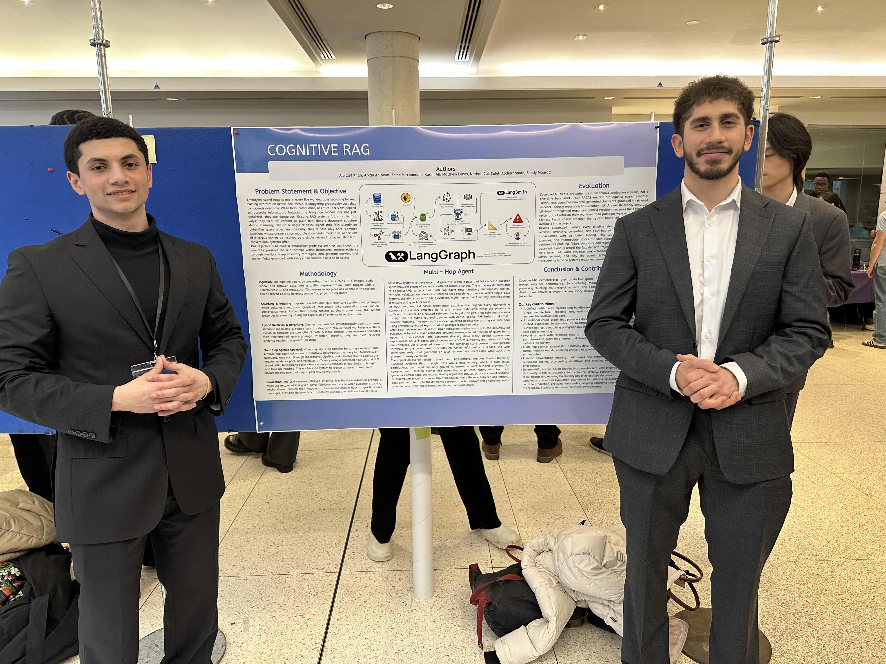
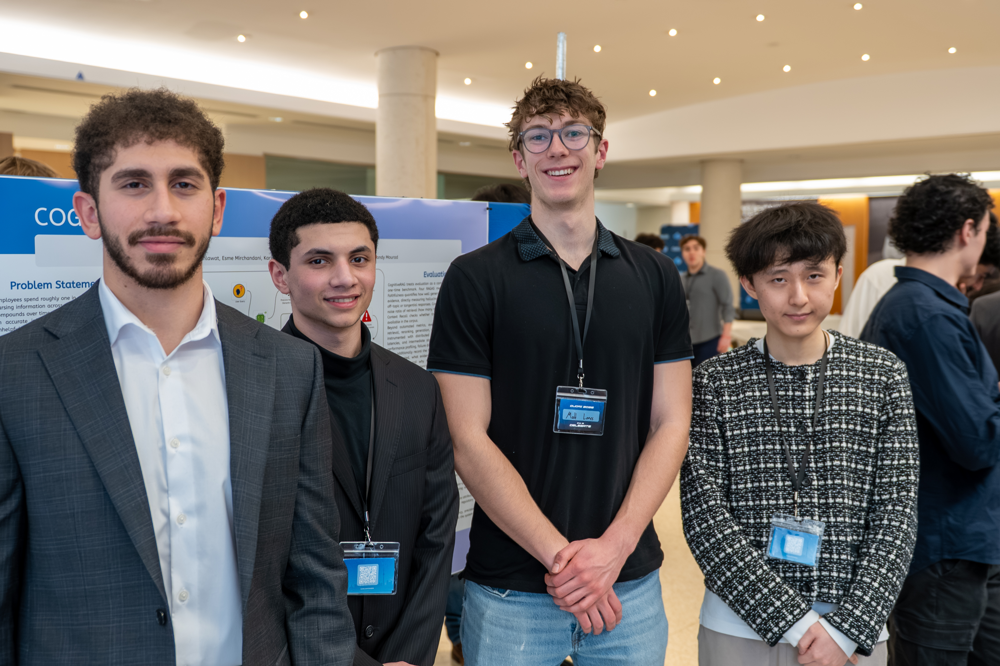

# CogRAG

## Overview

CogRAG was an AI/ML consulting project focused on developing and deploying a production-grade multimodal Agentic RAG platform. The platform improved knowledge access through embedding-based retrieval and scalable data pipelines.

## Objectives

- Build a reliable multimodal retrieval-augmented generation platform.
- Improve knowledge access through embedding-based search and generation.
- Deliver a scalable workflow from data ingestion through evaluation.

## Contributions

- Served as AI/ML Consulting Project Manager from June 2025 to February 2026.
- Co-led the development and deployment of the multimodal Agentic RAG platform.
- Delivered the end-to-end RAG workflow: ingestion, embedding, retrieval, vector database integration, and evaluation.
- Practiced SDLC ownership across a five-engineer team.
- Instituted code review standards, CI/CD automation, and API documentation to maintain high operational quality.

## Technologies

AWS Bedrock, LangChain, embedding-based retrieval, vector databases, multimodal AI, CI/CD, API documentation

## Results

- Delivered a production-grade Agentic RAG platform with scalable data pipelines.
- Improved the reliability and maintainability of the system through structured reviews, automated delivery, and documented APIs.

## Media

## Images

