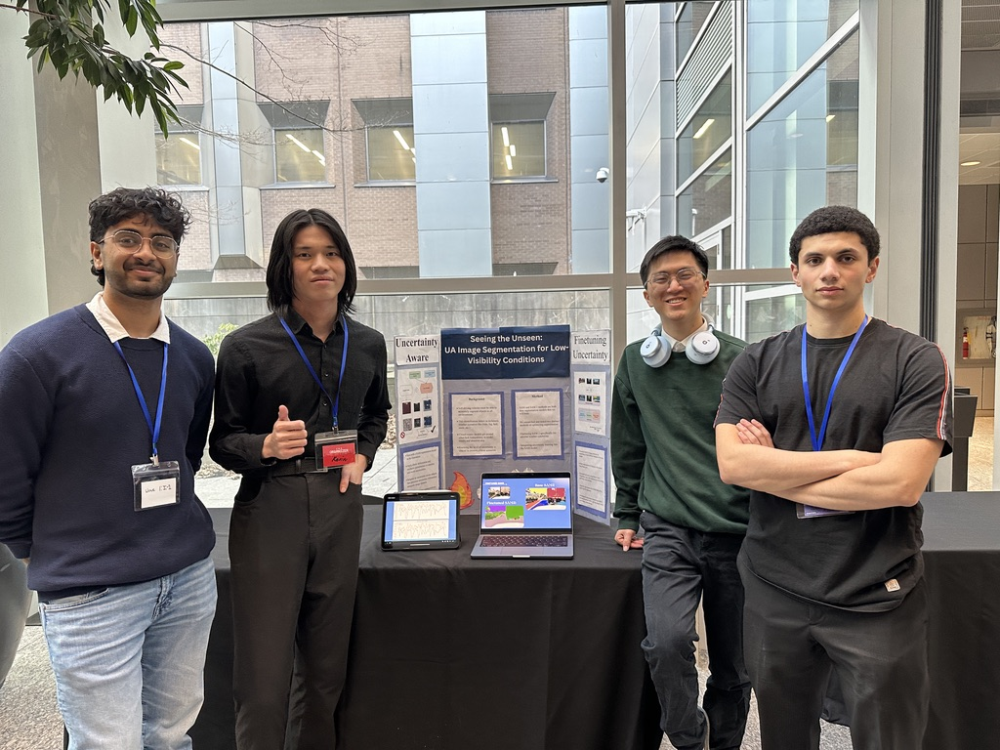
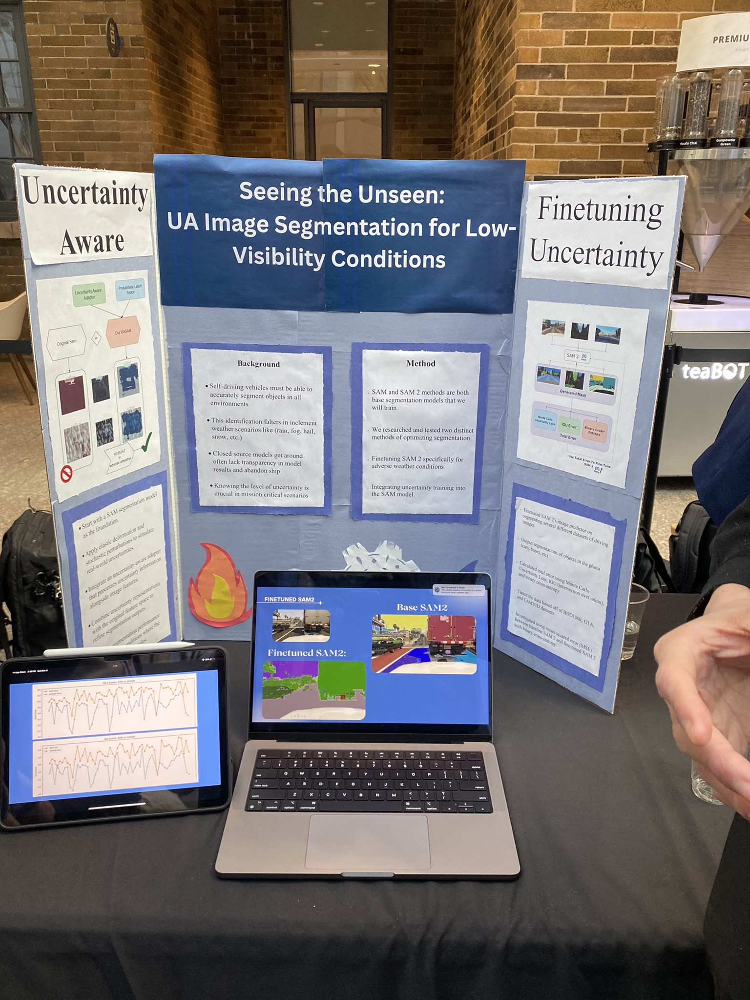

# Enhancing SAM

## Overview

This project investigated uncertainty-aware segmentation approaches using the Segment Anything Model (SAM) for adverse-weather autonomous-driving conditions. The work was presented at CUCAI and published in MDPI Electronics.

## Objectives

- Improve segmentation reliability in adverse-weather image distributions.
- Incorporate uncertainty into training and evaluation for high-stakes perception systems.
- Validate performance using weathered and elastically deformed images representative of operational variability.

## Contributions

- Co-developed and evaluated uncertainty-aware segmentation approaches using SAM.
- Fine-tuned SAM2 with uncertainty metrics integrated into the loss function.
- Implemented an uncertainty-aware adapter and trained it on weathered and elastically deformed images.

## Technologies

SAM, SAM2, image segmentation, uncertainty-aware training, computer vision, deep learning

## Results

- Improved segmentation performance by up to 49% in IoU and Dice through multi-step SAM2 fine-tuning.
- Achieved 43% and 30% improvements in IoU and Dice, respectively, with the uncertainty-aware adapter.
- Presented the work at CUCAI and published it in MDPI Electronics.

## Media

## Images

