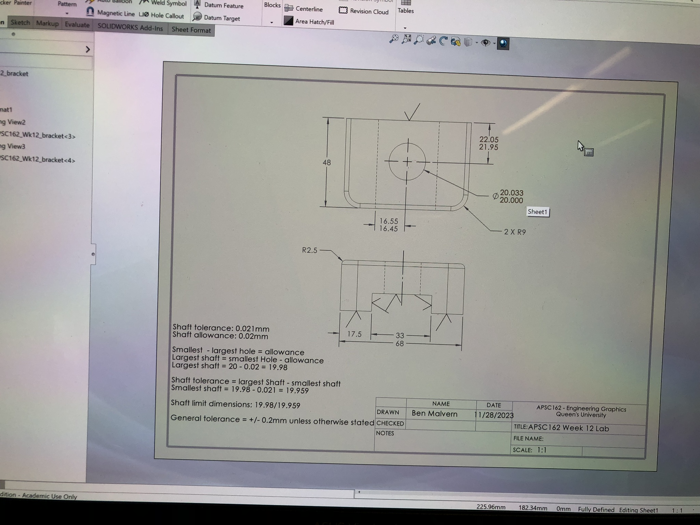
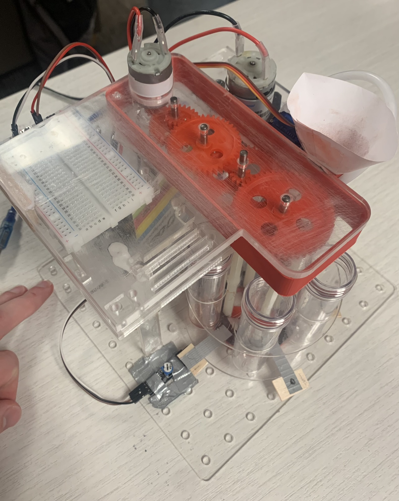

# Fluid Despenser

## Overview

<!-- Add a short description of the project. -->

## Objectives

<!-- Describe the main goals and requirements. -->

## Contributions

- Led a team in designing and building a microcontroller-based fluid dispenser.
- Developed the system using C, Arduino, and SolidWorks.

## Technologies

C, Arduino, microcontrollers, SolidWorks

## Results

- Achieved dispensing accuracy of ±1 g / 2 mL.
- Exceeded client expectations by 50%.

## Media

## Images

