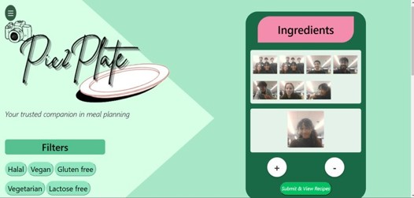

# Pic2Plate

## Overview

Pic2Plate is a full-stack application that generates relevant recipes from the groceries available to a user.

## Objectives

- Identify grocery items from user-provided images.
- Generate practical recipes based on the detected ingredients.
- Combine computer vision, web data, and application services into a responsive user experience.

## Contributions

- Contributed to the development of the full-stack application and its recipe-generation workflow.
- Developed the back end, including API integrations, web scraping, and object-classification services.
- Trained a YOLO model with 85% accuracy to detect more than 50 grocery items from user images, enabling near-real-time recipe generation.
- Developed monetization strategies through financial feasibility analysis.

## Technologies

<!-- Add the specific frameworks and services used in the application. -->
- YOLO object detection
- Computer vision and object classification
- API integrations and web scraping
- Full-stack application development

## Results

- Achieved 85% detection accuracy across a vocabulary of 50+ grocery items.
- Enabled recipe recommendations based on ingredients detected directly from user images.
- Evaluated financially feasible monetization strategies for the application.

## Media

