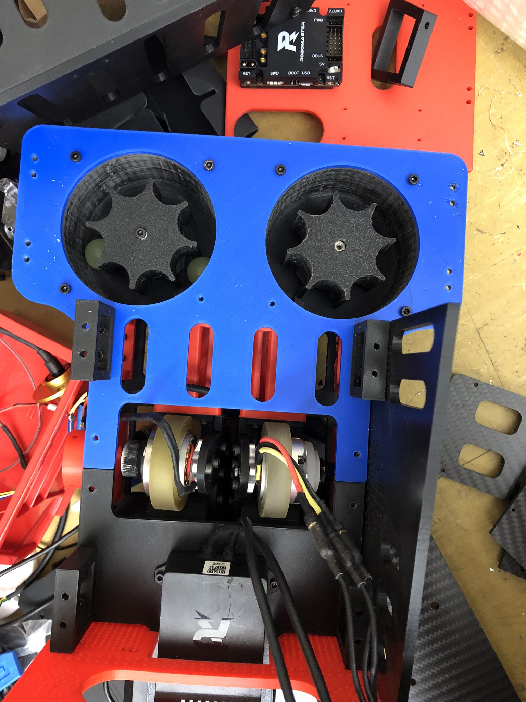
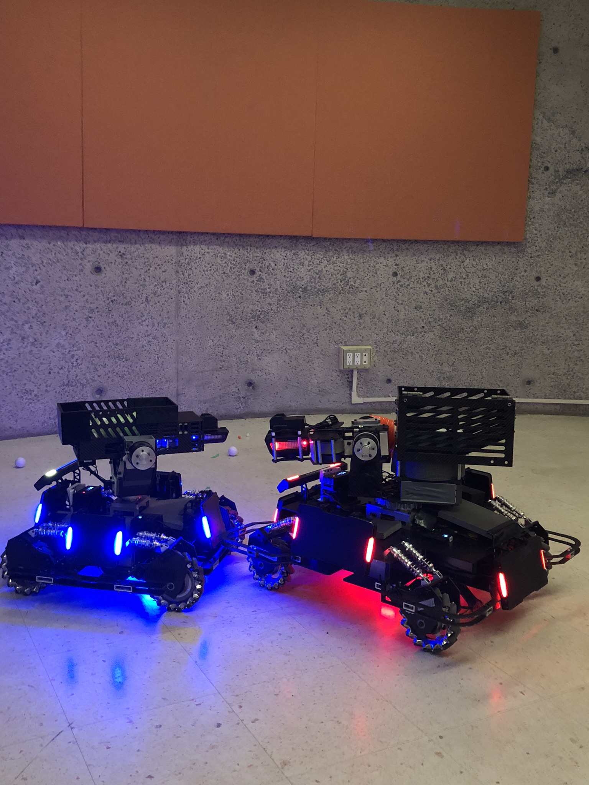
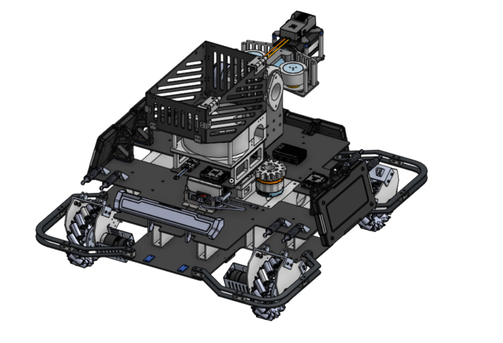

# QKRT

## Overview

The Queen's Knights Robotics Team designed, built, and assembled robots for DJI RoboMaster competitions.

## Objectives

- Coordinate the design and construction of competition-ready robots.
- Support a multidisciplinary engineering team preparing for the DJI RoboMaster North America Competition.

## Contributions

- Led a team of 15 engineering students in designing, building, and assembling multiple robots for the DJI RoboMaster North America Competition.
- Contributed to the construction of three robots that competed in the DJI RoboMaster University Series competitions.

## Technologies

<!-- Add the specific mechanical, electrical, and software tools used by the team. -->

## Results

- Secured 1st in Canada and 5th in North America in the DJI RoboMaster University Series competitions.

## Media

## Images

